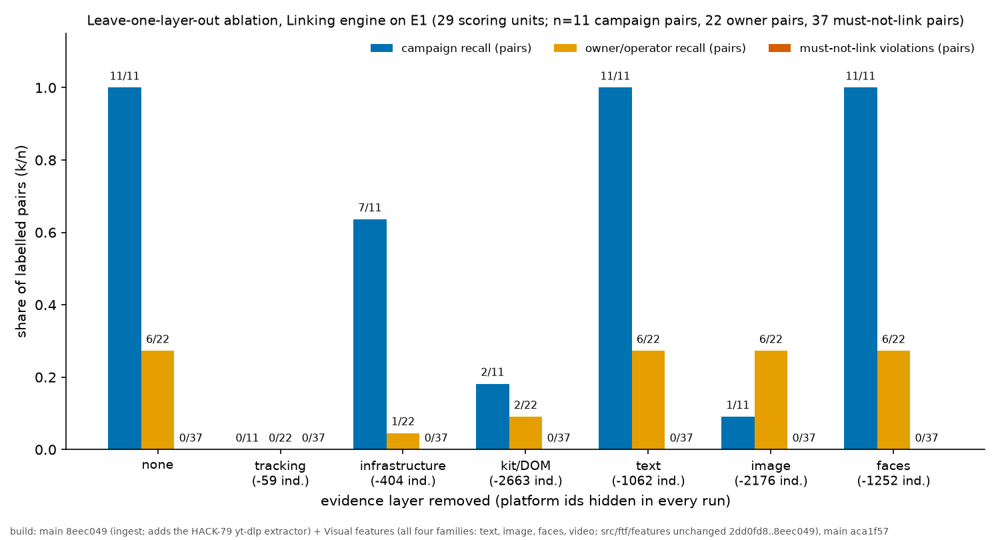
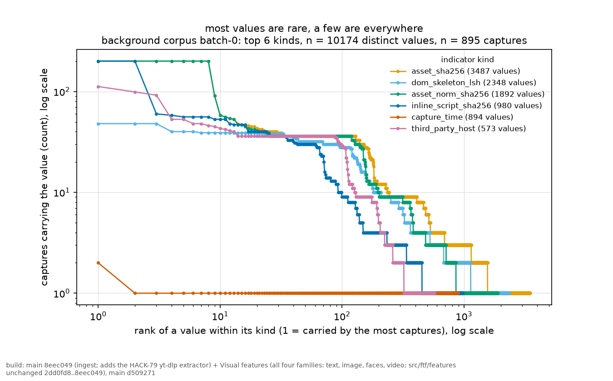
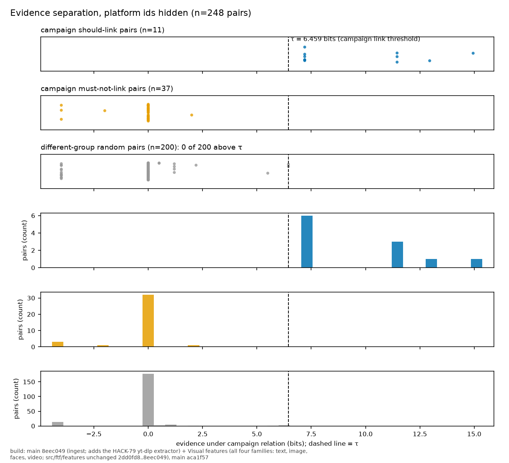
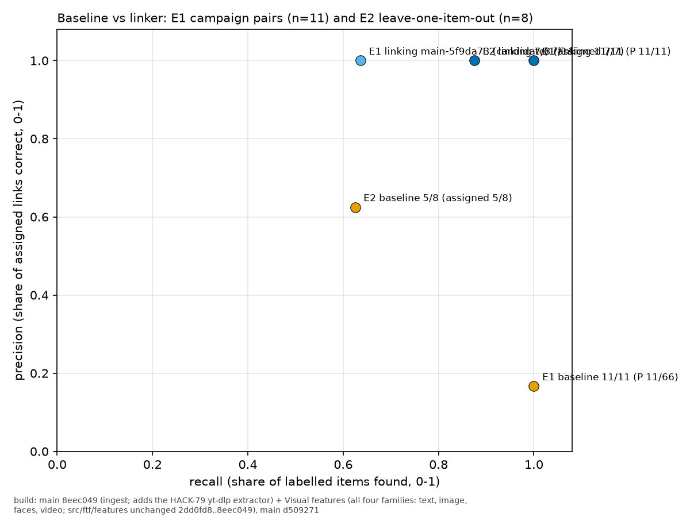

# Follow the Fake

Follow the Fake is a tool for the NASK PIB challenge "Kolekcjoner fejków". Scam ads that use the faces of well-known people arrive one at a time, and each looks like a one-off. The tool turns each suspicious item into captures, compares them with everything already seen, and shows which ones were probably made by the same people, with the evidence for every link.

Challenge data lives in a private bucket and never in this repository.

## 1. Methodology and model

### What the tool does

Starting from one suspicious item (an ad, a saved page, a URL or a keyword), the tool asks the analyst's question: which other items did the same people make?

1. **Capture.** A saved ad, page, HAR file or video is read as inert bytes. A URL is opened once in a locked-down headless browser (`ftf fetch`), which keeps the traffic, the final HTML and the redirect chain. Live scam pages are fetched only on an isolated sandbox machine. Ad libraries are searched by keyword (`ftf scan`). The tool never submits a form and never runs a saved script.
2. **Extract.** Each capture yields indicators, filed under layers such as tracking account, kit, infrastructure or face.
3. **Enrich.** Domains are looked up in four keyless public services. Enrichment is online by default and falls back to a cache when the network is down. A failed lookup becomes "unknown", never an error.
4. **Link.** Each pair of captures gets a score in bits. A shared value is worth bits only if it is rare. The engine then assigns the new item to a known campaign, starts a new campaign, or sends it to review.
5. **Show.** The app shows the campaign with each link and its evidence; every link score and verdict can be traced to rows of the evidence ledger. `ftf export` writes the same result as CSV tables.

Terms used throughout:

- An **incident** is one item in the organiser's material: a case folder, or one of the ad-hoc inputs.
- A **capture** is one saved visit or item inside an incident: an ad, a pre-lander, a lander or a decoy. Exact duplicates collapse onto one capture.
- A **campaign** is a group of captures made by one operation. A **link** is an edge between two captures whose evidence clears the threshold.
- **Assign**, **new** and **review** are the three verdicts for a new item.

### Features, layer by layer

A campaign keeps some layers and changes others. A scammer can rotate the creative and the domain and keep the tracking account and the page build, so each layer is scored on its own. In the tables, "strength" is how much one shared value says about one campaign, on its own.



*Campaign recall rests on tracking accounts (0/11 without them), image hashes (1/11), kit and page structure (2/11) and partly infrastructure (7/11). Removing text or faces changes nothing, and no must-not-link pair is linked in any run.*

#### Technical infrastructure

We extract registrable domains, the redirect chain, hosting IP and ASN, nameserver host, registrar, creation date, certificate issuer, mail servers, and the tracking domains that receive clicks and postbacks. Trackers and pixels (Meta pixel, conversions gateway, Google Ads, analytics ids) sit in this layer too, but tracking ids are scored as their own layer.

**Why it is evidence.** Operators buy domains in batches, point them at the same name servers and reuse their tracking accounts. Infrastructure therefore says who runs a domain, not which campaign it belongs to.

| Signal | Example | Strength | Why |
| -- | -- | -- | -- |
| Live tracker or pixel id | one Meta pixel in the traffic of two captures | strong for the operator, medium for the campaign | operators reuse tracking accounts |
| Tracker postback domain | one click-tracker receiving postbacks from several captures | strong for the operator | one operator runs its trackers |
| Rare nameserver host | used by at most 1% of background domains | medium | shared by 5 of the 11 should-link pairs |
| Rare registrar | used by at most 1% of background domains | weak to medium | shared by 6 of the 11 should-link pairs |
| Shared IP or CDN edge | a Cloudflare address | none to weak | one address serves many unrelated sites |
| Shared certificate | other names on the same certificate | not tested | the certificate log answered for 5 of 26 domains |

Across the test set, 9 of the 11 should-link pairs share a nameserver host, a registrar or an IP seen in at most 1% of background domains; only 2 of the 32 must-not-link pairs do. A shared IP alone splits 2 from 2, because shared hosting and Cloudflare are hubs (see [docs/linking-decisions.md](docs/linking-decisions.md)). Public lookups often fail, so many domains carry "unknown" here (section 2).

#### Page structure and kits

A kit is the build of a page: its asset hashes, a normalised hash of its inline scripts, the skeleton of its tags and the landing template. A page builder injects the same SDK files into every page it hosts; we record those at platform level.

**Why it is evidence.** Operators change the creative and keep the build, so a rare skeleton or inline script, carried by at most two groups, ties one campaign's pages together. A shared kit on its own points to a template, not an operator, because kits are sold and copied.

| Signal | Example | Strength | Why |
| -- | -- | -- | -- |
| Shared kit assets | the same set of asset hashes | medium, template level | copied kits sit on other operators' sites |
| Corroborated landing build | the same rare skeleton and a rare creative | medium to strong, campaign level | operators change the creative and keep the build |
| Platform constants | the SDK file a page builder injects | none for the campaign | every tenant gets the same file |
| Brand skin | a logo, font or analytics id copied from the outlet | ecosystem only | scam clones copy real outlets |

Brand skin is removed by a stop-list built from real outlet pages (see [Data and sources](#data-and-sources)).

#### Text

We extract the OCR text of each screenshot, the visible page text, a MinHash signature of word 5-grams with names masked, a multilingual sentence embedding (384 dimensions), the names and keywords in the text, and a rough topic (investment, crypto or health).

**Why it is evidence.** One operator reuses the same article across campaigns and swaps the celebrity. Masking the names exposes the swap.

| Signal | Example | Strength | Why |
| -- | -- | -- | -- |
| Embedding similarity | cosine at or above 0.952 | strong, opt-in | separates the 12 campaign pairs from the 44 must-not-link pairs |
| Masked article text | the same text with one name swapped | strong as content | the swap survives masking |
| Boilerplate in real pages | navigation and footers | none alone | 201 of 2,145 pairs of genuine pages from one outlet cross the cut |

Example: BACKUP p3 and p4 are one article with one name swapped. The masked overlap is 0.63 and the embedding cosine 0.95, where unrelated pages have a median overlap of 0.

Article text is the cleanest campaign signal we have: campaign pairs sit at or above 0.952, must-not-link pairs at 0.938 or below. (This check covers all 12 campaign pairs; E1 works on a slightly different set of 11.) Yet text links nothing in the default run, and removing it changes no campaign pair in this sample. It counts only with calibrated content views switched on (`--content-views`), and even then never makes a link or an assignment alone, because the calibration is weak: Cllr is 0.55 to 0.64 on 11 positive pairs, measured in-sample.

#### Images

We compute three perceptual hashes (pHash, dHash, PDQ) of each creative, screenshot and asset, plus an image embedding (SigLIP 2, 768 dimensions).

**Why it is evidence.** Creatives are reused, and the hashes catch reuse after re-encoding or the colour filters kits use to make copies look unique. But stock photos, kit assets and outlet logos repeat across unrelated cases too, and a hash cannot tell a reused creative from a stock photo two operators picked. Images are supporting evidence only.

| Signal | Example | Strength | Why |
| -- | -- | -- | -- |
| Near-duplicate (pHash distance 8 or less) | a re-encoded creative in another incident | medium | 151 of 419 still images (36%) have one elsewhere |
| Image embedding similarity | a cropped or resized copy | medium | tolerates crops better than the hashes |
| Stock or kit image | the same stock photo in unrelated cases | none | some must-not-link pairs have cosine 1.0 and pHash distance 0 |

#### Faces and brands

We extract the faces in each creative and page: a 128-dimension vector per face, matched against a reference set of 33 public figures whose portraits have open licences. We also list the outlets, TV channels, banks and companies a page names.

**Why it is evidence.** Two captures that use the same people are a clue. Unrelated operators borrow the same celebrities, though, so one face proves nothing: Rafał Brzoska appears in 6 incidents, and a link through him alone says nothing.

| Signal | Example | Strength | Why |
| -- | -- | -- | -- |
| Confident face match (cosine 0.40 or more, an analysis cut, not a code threshold) | 117 of 626 faces (19%) in 16 incidents | medium, in combination | says "same celebrity", not "same campaign" |
| Recurring public figure | Szymon Hołownia, Rafał Brzoska, Mateusz Morawiecki, each in 6 incidents | weak alone | several unrelated operators use them |
| Three or more named faces in common | in the analysis, campaign pairs share at least 3, must-not-link pairs at most 1 | medium, in combination (an analysis finding, not a rule in the code) | the combination separates the pairs |
| Brand overlap | an outlet or bank named on the page | ecosystem only | a clone names the outlet it copies |

In the default run, with content views off, a face or a brand counts only as "same ecosystem", never as "same campaign"; removing faces changes no campaign pair in this sample. With `--content-views` on, a face match can add up to 1 bit at campaign level, and it still never decides a link alone. Coverage of the reference set is the limit (section 2).

#### Video

We extract keyframes at scene changes and the image features of each. For screen recordings the phone's status bar is cropped before OCR, so the recording time never becomes evidence. Speech-to-text is optional.

**Why it is evidence.** A video often shows the landing page the saved files lack. It adds content, not links.

| Signal | Example | Strength | Why |
| -- | -- | -- | -- |
| Keyframe OCR text | the landing page text in case 14 | medium as content | the static files do not contain it |
| Keyframe image match | a keyframe matching another incident's still | none in this data | no keyframe matched a still elsewhere |

Case 14 is a 249-second iPhone screen recording. It gives 40 keyframes, and its OCR shows the landing page the saved HTML lacks. The features took about 55 seconds of wall time and 149 seconds of CPU. Across three videos (cases 5, 14 and 47) we get 125 keyframes and 107 OCR texts; no keyframe matches a still from another incident.

### How linking works

For each pair of captures the engine asks: how much evidence do they share that the same people made both? It answers in bits. One bit is a factor of two in likelihood.

#### Evidence in bits

A shared value counts only if it is rare. For each shared value:

    bits = max(max(prior × scale − discount, 0) − log2(k), 0)

- **prior** is the weight of the kind of value, set by hand: a tracking pixel 3.0, a tenant id 6.0, a kit asset set 2.5 to 6.5 depending on the kind of asset, a shared IP 1.5, a registrar 0.5. The priors are a starting point, not values fitted to the challenge data.
- **scale** is how much the layer says about the relation tested. A kit says a lot about a template and little about an operator.
- **discount** is 1.0 bit for a private id (tenant, owner, tracker, pixel) not seen live on both sides, because a copied kit can carry the original's ids.
- **k** is the number of groups carrying the value. The more groups share it, the less it is worth. A value worth less than 0.5 bit after this step is a **hub**: the ledger shows 0 bits, and it never proposes a pair. A value carried by more than 500 captures never proposes a pair.



*In a background corpus of 895 captures, 57% of the 10,174 distinct values of the six most common indicator kinds occur on a single capture, while a handful occur on hundreds, which is why evidence is weighted by rarity.*

Within one layer only the best shared value counts. Across layers the bits add, on the assumption that different actors set different layers.

#### What is ignored, and why

- **Analyst traces.** A fingerprint, a viewport, an analyst address or a capture date describes the person who captured the page, not the scam. These recur across unrelated cases, so they are excluded by type: they show 0 bits, and injecting identical traces changes no decision.
- **Platform constants and creative values** (an ad id, a celebrity photo) count only together with a value below platform level.
- **Conflicts.** A tenant or owner is single-valued per page. If two captures show different tenant or owner values, the pair gets −4 bits and can never link. A conflict on a platform costs bits only, because one operator can run several platforms.
- **Missing evidence** scores 0 bits, never a penalty. If a capture has no HAR, its tracking layer is missing for that pair, and the ledger says so.

#### Thresholds: edge, assign, new, review

**Edge.** A pair links when its score reaches τ and it has enough separate layers. For the operator and tracking-account relations, a live private id is enough on its own; for campaigns it must come with a second layer.

    τ = log2(n / m) + 3

Here n is the number of captures and m the typical size of one campaign. The "+3" is a safety margin, and the code floors log2(n / m) at 0, so τ is never below 3 bits. With 30 captures and campaigns of about 3, τ is 6.3 bits.

**Assign.** With K known campaigns, an item is assigned to the best one only when all three hold: its best score is at least τ + log2 K (the assign bar); the best campaign leads the runner-up, the next campaign that could itself be assigned, by at least 1 bit; and no conflict puts it there.

**New.** The item starts a new campaign when its best score is at most τ − 3 and its evidence capacity, the bits its inputs could still add, can reach τ.

**Review.** Everything else goes to review, with the candidate campaigns named and the missing inputs listed. An item whose capacity is below τ goes to review, never to new; a screenshot alone carries almost no evidence, so it is never new by default.

#### Worked example

The values are invented; the priors, the rarity rule and the thresholds are the code's. The collection has 30 captures, so τ is 6.3 bits. The new item is compared with 17 known campaigns, so the assign bar is 10.4 bits.

**Pair A: a rare landing id and a rare tracker id, both live on both sides.**

| Layer | Shared value | Prior × scale | k | Bits |
| -- | -- | -- | -- | -- |
| tracking account | pixel shared by two captures | 3.0 × 1.0 (live on both sides) | 1 | 3.0 |
| landing | landing id in both paths | 4.0 × 1.0 | 1 | 4.0 |
| **Total** | | | | **7.0** |

7.0 bits clears τ with two separate layers, so the pair is an edge. It is below the assign bar of 10.4, so a new item that matches only this pair goes to review, with the candidate campaign named. Had the pixel not been seen live on both sides, the 1.0-bit discount would leave 2.0 bits for it and 6.0 in total: below τ, no edge.

**Pair B: the same Cloudflare edge address.**

| Layer | Shared value | Prior × scale | k | Bits |
| -- | -- | -- | -- | -- |
| infrastructure | shared edge IP | 1.5 × 1.0 | 4 | 0 |

Four groups carry the address, so the rarity term (log2 4 = 2) takes all of its weight. It shows as a hub with 0 bits. Both ledgers are kept, so an analyst can see why Pair A is a candidate and Pair B is nothing.

#### Why review rather than a wrong link

A wrong link merges two campaigns and hides the difference between them. A wrong "new" leaves one campaign split in two, which an analyst can join later. A review tells the analyst where to look. The hard cases in the linking decisions record show the trade-off:

- **Missing platform ids (do_udostepnienia:1 and :2).** With platform ids hidden, :1 scores 4.95 bits against BACKUP:p15: the tracking pixel gives +3.0, the landing kit +1.25 and the platform software +0.7. That is below the assign bar of 9.3 bits, so both items go to review. The ground truth puts them in BACKUP's campaigns, so review is a miss, but no wrong assignment was made. For :2 the strongest candidate is BACKUP:p5, a different campaign, at 7.7 bits; lowering the bar would have sent :2 there.
- **The one we miss (do_udostepnienia:3).** It has no HAR, and its platform software name differs from the target campaign's. It scores −4.0 bits against the right campaigns, so it was called new. That is a miss, and we report it as one.

### What the data shows

The organiser gave us 26 case folders. With 2 ad-hoc inputs from the scam-link list that makes 28 incidents. The evaluation has 34 captures, 33 after removing duplicates.

The wider corpus is much bigger: seven batches and over 150,000 indicators, built with the same extractors. It is background for rarity and a source of hard negatives, not training data; the organiser cases are too few to learn from.

| batch | what it is | size |
|---|---|---|
| batch-0 | Meta Ad Library ads, Google Ads Transparency Center ads, CERT Polska warning-list landers | 867 incidents, 82,064 indicators |
| batch-1 | real pages that must not link: news, banks, brands, public bodies | 58 pages |
| batch-2 | Google Ads Transparency Center ads | 26 ads |
| batches 3 to 5 | fresh Ad Library items, nearly all with live landers | 23 items |
| batch-6 | newly listed CERT Polska domains | 815 domains, 58,325 indicators |

<!-- eval:ground-truth start -->
#### Ground truth and leak check

| item | count |
|---|---|
| captures (with duplicates) | 34 |
| canonical captures | 33 |
| case folders (incidents) | 26 |
| analyst must-not-link pairs | 44 |
| leak check hits (expected 0) | 0 |
| hidden indicators (removed) | 164 |

The pair counts differ between tables. The ground truth has 44 must-not-link pairs; E1 counts 37 of them and E4 counts 43. Each table states its own base.
<!-- eval:ground-truth end -->

#### What operators reuse and what they rotate

- **Platform ids decide almost everything.** A scam's own tracking and platform ids are the strongest link; with them visible, campaign grouping is perfect. The engine has to work without them, and E1 measures that.
- **Operators reuse tracking accounts and kits across campaigns.** Counting them as campaign evidence produced 4 wrong campaign merges, so the campaign gate never counts a pixel on its own.
- **Tenants mix owners.** One reseller tenant hosts several owners. Cases 48 and 61 share it and are still different campaigns.
- **Campaigns rotate the creative and the domain.** The landing skeleton often stays.

#### Surprises

- **Boilerplate is not campaign-specific.** Real outlets share navigation and footers, and 201 of 2,145 pairs of genuine pages from one outlet cross the text cut. A scam page compared with the outlet it imitates stays below it (maximum 0.916).
- **Colour filters do not hide reuse.** On 14 known re-encoded or hue-shifted pairs, against 2,500 unrelated pairs, every image hash and the image embedding separated them (AUC 1.0).
- **Folder 2 holds two sites.** Case 3's own HAR file sits in folder 2, so case 3 stays a named miss. That is an input problem, not a linking one.

### Results

Seven experiments, E1 to E7, ran in 13 steps, all `ok`. The 33 canonical captures form only 3 non-singleton campaign groups, so read the tables as a regression check, not a benchmark. E1, E6 and E7 hide the platform ids; E2, E3 and E4 show all evidence. Content views were off (the default).



*With platform ids hidden, all 11 same-campaign pairs carry more evidence than the link threshold τ = 6.46 bits, while none of the 37 must-not-link pairs and none of 200 random different-campaign pairs reaches it.*



*A link-anything-shared baseline finds all 11 campaign pairs but only 11 of its 66 links are right. The linker finds 11/11 with every link right, and under leave-one-incident-out it assigns 7 of 8 held-out items correctly with no wrong campaign.*

Figures: organiser build main 8eec049 with the visual features, code main aca1f57, platform ids hidden.

<!-- eval:build start -->
Dataset build: the final report ran on main 5354603.
<!-- eval:build end -->

#### E1: can the engine find the campaigns without platform ids?

With platform ids hidden, the engine finds 11 of 11 campaign pairs, every pair it predicts is correct (11 of 11), and it violates 0 of 37 must-not-link pairs. The baseline finds the same 11 pairs, but only 11 of its 66 predicted pairs are true, and it violates 34 of 37.

<!-- eval:e1-hidden start -->
| relation vs level | baseline pairwise | linking pairwise | baseline macro B-cubed P / R | linking macro B-cubed P / R | must-not-link violated, baseline | must-not-link violated, linking |
|---|---|---|---|---|---|---|
| campaign vs campaign | P 11 of 66 pairs, R 11 of 11 pairs | P 11 of 11 pairs, R 11 of 11 pairs | 0.14 / 1.00 over 7 groups | 1.00 / 1.00 over 7 groups | 34 of 37 pairs | 0 of 37 pairs |
| operator vs owner | P 22 of 66 pairs, R 22 of 22 pairs | P 6 of 6 pairs, R 6 of 22 pairs | 0.20 / 1.00 over 5 groups | 1.00 / 0.78 over 5 groups | 1 of 1 pairs | 0 of 1 pairs |
| operator vs tenant | P 23 of 66 pairs, R 23 of 23 pairs | P 6 of 6 pairs, R 6 of 23 pairs | 0.25 / 1.00 over 4 groups | 1.00 / 0.60 over 4 groups | 1 of 1 pairs | 0 of 1 pairs |
<!-- eval:e1-hidden end -->

<!-- eval:e1-final start -->
E1 as each method component is added (platform ids hidden):

| method | campaign pairs found | what changed |
|---|---|---|
| identifier layers only | 0 of 11 | tracking, kit and infrastructure layers |
| + content features (faces, images, text) | 4 of 11 | face, image and text layers counted |
| + corroborated landing build | 7 of 11 | corroborated landing builds count as campaign evidence |
| + same-host landers form one site | 11 of 11 | captures of one incident on the same host form one site |
<!-- eval:e1-final end -->

We would not lean on the 11 of 11:

- **It is in-sample.** The 11 campaign pairs come from 3 independent groups, and the rules were developed while looking at them. The honest figure is leave-one-incident-out in E2: 7 of 8 right, 0 wrong.
- **Four pairs depend on one design choice.** In the ablation, dropping the same-host rule leaves 7 of 11; a reasonable change to that rule would drop them.
- **Operator links are weak.** The engine finds 6 of 22 owner pairs and 6 of 23 tenant pairs. It finds campaigns, not operators.

#### E2: leave one incident out

We remove one incident, build the base without it, and ask where it belongs.

<!-- eval:e2-openset start -->
| engine | protocol | mode | items | correct | wrong campaign | new | review | assigned | median capacity (bits) |
|---|---|---|---|---|---|---|---|---|---|
| baseline | loco | full | 8 | 0 | 8 | 0 | 0 | 8 | 153.00 |
| baseline | loco_mixed | full | 2 | 1 | 1 | 0 | 0 | 2 | 223.00 |
| baseline | loo_item | full | 8 | 5 | 3 | 0 | 0 | 8 | 153.00 |
| linking | loco | full | 8 | 0 | 0 | 8 | 0 | 0 | 48.40 |
| linking | loco_mixed | full | 2 | 1 | 0 | 0 | 1 | 1 | 48.40 |
| linking | loo_item | full | 8 | 7 | 0 | 0 | 1 | 7 | 48.40 |
<!-- eval:e2-openset end -->

The Linking engine gets 7 of 8 incidents right with 0 wrong; the baseline gets 5 right and 3 wrong. The one miss goes to review, not to a wrong campaign. Leaving a whole group out (loco) gives the Linking engine 0 correct and 8 new, which is the honest cost of a group with no other member in the base. With 8 items, one item moves any rate a lot.

#### E3: degraded inputs

The held-out item keeps only one kind of input.

<!-- eval:e3-degraded start -->
Summary for `loo_item`, 8 items per row:

| input kept | baseline correct | baseline wrong campaign | linking correct | linking wrong campaign | linking new | linking review |
|---|---|---|---|---|---|---|
| full | 5 | 3 | 7 | 0 | 0 | 1 |
| HAR | 5 | 2 | 7 | 0 | 0 | 1 |
| HTML | 5 | 3 | 0 | 0 | 5 | 3 |
| screenshot | 4 | 1 | 0 | 0 | 0 | 8 |
| ad text | 0 | 0 | 0 | 0 | 0 | 8 |
| URL only | 0 | 0 | 0 | 0 | 0 | 8 |

The full `loco` and `loco_mixed` tables are in the evaluation report.
<!-- eval:e3-degraded end -->

Screenshot-only, ad-text-only and URL-only items all end in review, never in a wrong campaign, which is what the design asks for. The weak point is HTML only: 5 of 8 items go to new. That is a miss, not a false link, and we say so in the demo.

#### E4: distractors

Cases that look like a link but are not one.

<!-- eval:e4-distractors start -->
| distractor | expected | baseline passed | linking passed |
|---|---|---|---|
| natural must-not-link pair (a) | no link or campaign between the subjects and the paired capture | 3 of 43 | 43 of 43 |
| synthetic kit copy (b) | no link or campaign between the subjects and outside captures; never assigned (new or review); template link to the original reported, not required | 0 of 3 | 2 of 3 |
| platform-only page (c) | no link or campaign between the subjects and outside captures; never assigned | 0 of 3 | 3 of 3 |
| collector invariance (injected fingerprint) (d) | zero decisions change | 2 of 2 | 2 of 2 |
| brand negative (e) | no link or campaign between the subjects and outside captures; never assigned | 9 of 58 | 58 of 58 |
| celebrity-only context (f) | no link or campaign between the subjects and outside captures; never assigned | 0 of 2 | 2 of 2 |

Must-not-link pairs violated: baseline 40 of 43, linking 0 of 43.
<!-- eval:e4-distractors end -->

The Linking engine passes every class except one synthetic kit copy, which still links (2 of 3 pass). In the brand row the baseline fails 49 of 58 real outlet pages. The brand and celebrity cases come from one batch and the kit copies are controlled edits, so a clean row says little about other sources.

#### E6: sensitivity to the weights

We move each hand-set weight by −2, −1, +1 and +2 bits, one at a time. A link that flips under a single-layer ±2 move is fragile.

<!-- eval:e6-sensitivity start -->
| relation | pair links (unperturbed) | pair flips, all moves | fragile links (±2, one layer) | worst-case only |
|---|---|---|---|---|
| campaign | 13 | 67 | 10 of 13 | 13 |
| ecosystem | 12 | 209 | 4 of 12 | 12 |
| operator | 7 | 55 | 6 of 7 | 7 |
| template | 1 | 21 | 0 of 1 | 1 |
| tracking_account | 0 | 3 | 0 of 0 | 0 |

Weights tested: 39 of 91 in the table; 16 flip no decision. In total, 20 of 33 pair links change verdict under one single-layer ±2 move.
<!-- eval:e6-sensitivity end -->

This is the weakest part of the result. Ten of the 13 campaign links flip under one ±2 move, and the output marks them as fragile. The honest reading of E1 is that these priors find the 11 campaign pairs; a different set of priors could find a different set.

#### E7: a later item arrives in time

The reference base is the 8 October captures (15 folders). Thirteen later items are assigned against it.

<!-- eval:e7-timesplit start -->
| engine | reference folders | later items | correct assignment | wrong assignment | false accept | correct new | missed (new, should assign) | review | bridging folders | fragmented groups |
|---|---|---|---|---|---|---|---|---|---|---|
| baseline | 15 | 13 | 3 | 0 | 7 | 3 | 0 | 0 | 12 | 0 |
| linking | 15 | 13 | 2 | 0 | 0 | 5 | 1 | 5 | 12 | 0 |
<!-- eval:e7-timesplit end -->

The Linking engine makes 0 false accepts, against 7 for the baseline. It assigns 2 items correctly, sends 5 to review and misses one that should have been assigned (do_udostepnienia:3). The baseline assigns 3 correctly but accepts 7 items that should be new. Caution costs the engine 5 items in review, which is the trade we chose.

#### Run status

<!-- eval:run-status start -->
| step | status |
|---|---|
| labels | ok |
| leak | ok |
| hidden baseline | ok |
| hidden linking | ok |
| timesplit baseline | ok |
| timesplit linking | ok |
| sensitivity | ok |
| openset baseline | ok |
| openset linking | ok |
| degrade baseline | ok |
| degrade linking | ok |
| distractors baseline | ok |
| distractors linking | ok |
<!-- eval:run-status end -->

#### Limits of the evidence

<!-- eval:limitations start -->
The sample is small: 33 canonical captures in 26 case folders, 3 non-singleton campaign groups and 13 later items, so these counts are a regression check, not a benchmark. Cluster sizes are skewed: the largest campaign group holds 5 of 33 captures, so pair counts are dominated by it and macro-averages over groups are reported next to them. The E7 time split uses the organiser's source set instead of a capture date for 4 of 13 later items, so it tests organiser sets rather than dates. The reference base is not grown during E7: each later item is assigned against the reference folders alone, so later items never join one another or the base. The synthetic distractors (E4) are built from one organiser batch, so they test the engine on controlled edits rather than on other sources. The brand negatives are one batch of pages, so a clean E4 result says little about other brands or sources. Open-set assignment (E2, all evidence) gives 0 wrong-campaign assignments out of 7 assigned items for the Linking engine, against 3 of 8 for the baseline, over 8 leave-one-item and 8 leave-one-group items, so one error moves any rate by a large step. False accepts, assignments of items that should be new, are counted in E7 only. The sensitivity check moves 39 weights by ±1 and ±2 bits one at a time: 20 of 33 pair links change verdict under a single-layer ±2 move, so their verdicts depend on the hand-set priors and are flagged as fragile. With platform ids hidden (E1) the Linking engine recovers 11 of 11 true campaign pairs: recall without the platform layer is 11 of 11, while precision is safe, with 0 of 37 must-not-link pairs violated. The baseline recovers 11 of 11 and violates 34 of 37.
<!-- eval:limitations end -->

## 2. Problems with gathering data

Each problem says what happened, what we did and what would work better; the last part is our view, not a result.

### Collection

**1. Scam pages die fast.** Landers live for hours or days. On batch-0, 566 CERT domains gave no page and only 143 gave a landing page. Of the 815 newest CERT domains, 96 (12%) were live, even through a Polish residential IP with a Polish phone profile. A dead page still gives the ad and the infrastructure. *Better:* fetch within hours of listing; every lander of the 51 new ads was live.

**2. Cloaking hides the scam.** A cloaked page shows a harmless white page to anyone who does not look like a Polish phone user on a home connection. A Polish mobile profile turned 56 of 235 cloaked pages on batch-0 into real scam pages. A fresh Google Cloud IP did not help: 83% of landers stayed cloaked. *Better:* a victim profile run from a home-like connection, after its own safety review.

**3. No Meta developer account.** The official Meta API was not open to us, so we read the public Ad Library pages with a headless browser. Meta's terms forbid automated collection, so the Meta source is a demonstration only. On one run, a sandbox IP got 0 ads. *Better:* the official Ad Library API, which needs a developer account and identity confirmation.

**4. Ad-library rate limits.** Google's Transparency Center answered HTTP 429 to 71% of requests from cloud IPs. *Better:* less volume per IP, or a sanctioned route as in point 3.

**5. Residential proxies.** A rotating Polish residential proxy (about 1.1 GB of traffic) unblocked the ad libraries: 148 Meta ads and 32 Google ads on one run, where the cloud IP got 0. It barely revived old cloaked landers (4 of 117). We use it for discovery only: it finds ads, it does not reveal the scam. *Better:* the freshness and profile work in points 1 and 2, with the proxy's cost and terms settled before any production use.

**6. Hostile pages.** Live scam pages were fetched only on an isolated sandbox VM, never on a laptop. Pages are stored as data and never run; the app shows URLs defanged. *Better:* a sandbox per batch, torn down after the run.

**7. Registry lookups fail.** RDAP failed for 226 of 254 older CERT domains, which are dead or sit under TLDs without RDAP. crt.sh returned HTTP 502 for most queries. The tool records "unknown" instead of failing, so the evidence is weaker but the run does not stop. *Better:* a certificate source that answers reliably, which would also make shared certificates testable.

**8. Little labelled data.** There are 26 organiser cases. The corpus gives background and hard negatives, not labels, so every result in section 1 carries that caveat. *Better:* more confirmed campaign and must-not-link pairs from CERT.

**9. Licences.** We had no legal opinion on the ad libraries' terms; collection used public pages without an account. The licence table is in [docs/licences.md](docs/licences.md).

### Features

**1. OCR is slow on CPU.** Some OCR calls timed out under load on the CPU VM, which lost that text. The limits are configurable: `FTF_OCR_TIMEOUT` (default 600 s per Tesseract call) and `FTF_VIDEO_TIMEOUT` (default 900 s per ffmpeg call). A timed-out image or keyframe is skipped with a warning, and the rest of the item goes through. *Better:* a GPU or a larger CPU for the OCR step.

**2. Face references are thin.** Few public figures have an openly licensed portrait. Widening the set from 11 to 33 people raised confident matches from 15.5% to 25.1% of faces, and two people still have none. The set loads from `FTF_FACE_REFERENCE`, and no organiser image is ever used as a reference. *Better:* a licensed portrait for every impersonated person.

**3. Look-alike outlet pages.** Scam pages copy outlet logos, fonts and analytics, and reuse celebrity photos. Before the brand stop-list and the gates, the baseline failed the E4 check on 49 of 58 real outlet pages, all 3 platform-only pages and both celebrity-only items; the Linking engine passes them. *Better:* a stop-list built from more outlets and batches; brand stock images still match unrelated cases.

**4. Platform ids dominate the evidence.** With platform ids hidden, the identifier layers alone find 0 of 11 pairs. The gain comes from the content features, the corroborated landing build and the same-host rule; in the final build, removing text or faces changes nothing (layer figure in section 1). *Better:* weights calibrated on labelled pairs, so the remaining layers are not only hand-set.

**5. Content views are not calibrated.** Every content view has an AUC of at least 0.99, but Cllr is 0.55 to 0.64, measured in-sample on 11 positive pairs. A variant that let text support decisions made the time split worse, so content views stay opt-in. *Better:* calibration on more labelled pairs.

## 3. What can be made better

Beyond the limits stated with the results:

- **The ground truth is ours.** The 44 must-not-link pairs and the labels come from the analysts. A different analyst might draw some groups differently.
- **The weights are priors.** They are hand-set bits, not fitted to the data. A learned table can be passed with `ftf link --weights`, but the default run keeps the hand-set priors.
- **Outside services can fail.** When a lookup or a live page is unavailable, the item carries less evidence and is more likely to go to review.

Next steps, ranked by expected gain:

| # | Step | Expected gain | Effort |
|---|---|---|---|
| 1 | Get more labelled pairs from CERT (confirmed campaign and must-not-link pairs) | high: removes most of the in-sample problem in E1 | medium, depends on CERT |
| 2 | Calibrate the content views on those pairs, so text can support a decision | high: text is our cleanest campaign signal | medium |
| 3 | Use nameserver and registrar in the campaign gate | medium to high: they split operator pairs well; a rare shared nameserver or registrar separates operators (5 vs 0 and 6 vs 1 pairs), but a copied kit keeps the original's infrastructure, so it needs a kit-copy guard first | low to medium |
| 4 | Grow the reference base in E7, so later items can join one another | medium: tests the realistic case | low |
| 5 | Test shared certificates once a certificate source answers reliably | medium: untested today | medium, depends on the source |
| 6 | Get a licence answer for reading Ad Library pages and for the face reference set | high for a real deployment, no effect on the score | low; depends on a licence answer |
| 7 | Re-run the evaluation on a fresh corpus; keep the evaluation blocks replaceable | medium: guards against overfitting | low |

## 4. How to run the demo

The image runs the `ftf` command. With no arguments it builds the campaign base if needed and serves the app, offline from a prebuilt base bundle or online with live lookups.

### Offline, without internet, from the base bundle

The offline package is an AES-256 encrypted 7z file. The link does not expire, and the password is never in the repository.

1.69 GB; sha256 `c61b56dfd1f03c1309f79c9022094f41e22e0b32efcf8b1e88d076e8a02bc521` (check with `sha256sum`). `7z x <file>` asks for the password and unpacks to `ftf-offline-package/`.

```bash
curl -LO https://storage.googleapis.com/ftf-pkg-9d5a7a89ee6a4981/ftf-offline-6de92251feecb7ff82f64098.7z
7z x ftf-offline-*.7z   # asks for the password: <PASSWORD>
# the app, offline: open http://127.0.0.1:8501
docker run --rm -e FTF_OFFLINE=1 -v "$PWD/ftf-offline-package:/data/package:ro" -e FTF_PACKAGE=/data/package -p 127.0.0.1:8501:8501 <image>
# the CLI with no network at all
docker run --rm --network none -v "$PWD/ftf-offline-package:/data/package:ro" -e FTF_PACKAGE=/data/package <image> analyze <INPUT>
```

The entry point reads the package through `FTF_PACKAGE`; its contents are described in [Data you receive](#data-you-receive).

Docker cannot publish the app's port from a container started with `--network none`, so the app runs with `FTF_OFFLINE=1` instead, which makes no network calls. The CLI line shows the strict form, with no network device at all. Enrichment answers come from the cache in the package, and a lookup that is not cached is recorded as `unknown`.

**Your own cases, offline.** Offline, a run reads only the files you give it, the campaign base and the enrichment cache. These work without a network: OCR text, image hashes, faces, the page skeleton, trackers and identifiers in the page or HAR, the redirect chain from a HAR, and linking against the base. A bare URL cannot be fetched offline, so submit the saved page (HAR or HTML) or the screenshot instead. Registry, DNS and certificate data for a domain outside the dataset comes out as `unknown`, because the cache covers only the dataset's domains. Measured with `--network none` on 4 cores: about 11 s for a screenshot, about 13 s for a HAR of one landing page, and about 2 s for a bare URL, including the network probe (about 0.02 s when there is no network).

### Data you receive

The offline package is one folder of 331 files, about 2.0 GB in total. Nothing in it is personal data of private people.

| Folder | Files | Size | What it is for |
|---|---|---|---|
| `base/` | 209 | 20.3 MB | the campaign base built from the challenge cases, with the extracted indicators and keyframes |
| `enrichment/` | 1 | 0.4 MB | cached RDAP, DNS and certificate answers for the dataset's domains |
| `models/` | 20 | 2.0 GB | the CPU feature models: text and image embeddings, face detection and face embedding |
| `face-reference/` | 99 | 8.2 MB | public-figure reference portraits, used to name faces that match them |
| `brand-stoplist/` | 1 | 0.2 MB | hashed outlet fingerprints, with no page content |
| `README.txt` | 1 | under 1 KB | what is inside and how to mount it |

### Online, with the base bundle

```bash
docker run --rm -p 127.0.0.1:8501:8501 -v "$PWD/base-bundle:/base:ro" ftf
# then open http://127.0.0.1:8501
```

Enrichment is online by default. A start probe (two DNS-over-HTTPS hosts) and a 5-second timeout per lookup (15 s for crt.sh, one retry) fall back to the enrichment cache and the precomputed base. After the first request that gets no answer the run stays offline, so a dead network costs about one timeout. The enrichment stage, the JSON summary's `enrichment` field and the app all say which source was used: `online`, `offline cache`, `mixed` or `no answer`.

`--offline` on `ftf analyze`, or `FTF_OFFLINE=1`, forces the cache. `--online` is a no-op. Live page fetching stays opt-in: `--fetch` or `FTF_FETCH=1`, and only when online. The image sets `FTF_FETCH=1`.

### Command-line equivalents

```bash
pip install -e .                 # the ftf command
pip install -e '.[app]'          # the demo app
ftf analyze INPUT --base dataset.json --out result.json   # online by default; add --offline for the cache only
ftf export --base dataset.json --out DIR
ftf serve --base dataset.json --port 8501
```

`ftf analyze` prints the verdict (assign, new or review) and exits 0 for all three. Inputs are copied to a per-run directory and hashed, never executed. Captured HTML is never rendered, and URLs are shown defanged.

`ftf export` writes `incidents.csv`, `captures.csv`, `indicators.csv`, `links.csv`, `evidence.csv` (one row per ledger row), `campaigns.csv`, a validated `dataset.json`, and `campaign_patterns.md`, which defangs every value. An export built from organiser data is never committed to the repository.

### Build the image

From a clean checkout of the repository root:

```bash
docker build -t ftf .
docker run --rm ftf --help
docker run --rm ftf --version
```

Without the stop-list file the build still works, and the engine warns and scores without it. The image is 5.57 GB (`docker images` size). It holds the CPU build of torch, the CPU feature models with the face reference set, tesseract and ffmpeg, and Playwright's headless Chromium, which `ftf fetch` needs. The build uses BuildKit (`COPY --chmod`); Docker 23 and later enables it by default, and older clients need `DOCKER_BUILDKIT=1`. The hardened run, the first start with the organiser's folder and the image leak check are in [docs/container.md](docs/container.md).

### Walkthrough

The walkthrough uses a slice of the challenge base (`base-h4-main`), with case 1 held out. Cases are named by their folder number.

1. **A known variant.** `do_udostepnienia:1`, held out, is assigned to the 7-capture campaign it belongs to. The best candidate scores 18.7 bits and the evidence capacity is 48.4 bits.
2. **A new campaign.** An unrelated saved page with no shared value against any campaign is declared **new**. Its evidence capacity is 44.9 bits.
3. **A screenshot-only item.** The ad screenshot of case 1, alone, goes to **review**. Its evidence capacity is 0 bits, so the system does not call it new.

These are the method's outputs with hand-set weights, not a measured accuracy.

### Environment variables

| Variable | Default in the image | What it does |
|---|---|---|
| `FTF_BASE` | `/base/dataset.json` if present | campaign base for the app and `ftf analyze` |
| `FTF_BASE_DIR` | `/base` | where the entry point looks for and builds the base |
| `FTF_RAW_ROOT` | `/data/raw` | organiser folder; artefact paths in the base are relative to it |
| `FTF_OFFLINE` | unset | `1` forces every network lookup off (same as `--offline` on `ftf analyze`) |
| `FTF_FETCH` | `1` in the image | `1` lets the app and `ftf analyze` fetch a submitted URL live (`--fetch`), only when online and `FTF_OFFLINE` is not set |
| `FTF_ENRICH_CACHE` | `/base/enrichment/cache.json` if present | enrichment cache file |
| `FTF_PORT` | `8501` | app port inside the container |
| `FTF_BRAND_STOPLIST` | `/opt/ftf-brand/brand-stoplist.json` | brand stop-list; `off` switches it off, a missing file warns |
| `FTF_FACE_REFERENCE` | `$FTF_MODEL_DIR/face-reference` | face reference set (in the image `/opt/ftf-models/face-reference`); `FTF_FACES_REFERENCE` is the older name, still read with a warning |
| `FTF_MODEL_DIR` | `~/.cache/ftf/models` | model directory outside the image |
| `FTF_OCR_TIMEOUT` | 600 | seconds per Tesseract call |
| `FTF_VIDEO_TIMEOUT` | 900 | seconds per ffmpeg call |
| `FTF_RUN_DIR` | system temp directory | per-run copies of the inputs |

The code also reads settings for threads, speech-to-text, image embedding and egress proxies; see `src/ftf/`.

## 5. Licences and repo layout

### Licences

Only permissively licensed open-source dependencies are allowed (MIT, BSD, Apache, PSF, ISC, HPND). `LICENSES-THIRD-PARTY.md` is generated from installed package metadata by `python3 scripts/licences.py`, and a test fails if it is stale or lists a licence outside the allowlist. The code in this repository is not under an open licence. Under the challenge rules the economic copyright to a winning solution transfers to NASK PIB.

Two named exceptions exist. `certifi` (MPL-2.0, unmodified) is pulled in through `requests` and `tldextract`. Playwright, its Chromium and its Node.js driver come only with the optional `fetch` extra. The per-package table is [LICENSES-THIRD-PARTY.md](LICENSES-THIRD-PARTY.md). System packages, models and outside services, with their licences and limits, are in [docs/licences.md](docs/licences.md).

### Data and sources

The challenge data (the case folders, the BACKUP archive and the link list) belongs to the organiser. It is kept in private cloud storage, never in this repository, and derived outputs are kept there too.

| Source | What we take | Terms and limits |
|---|---|---|
| Challenge cases | saved ads, pages, HAR files, screenshots, metadata | not redistributed; used for the challenge only; never in git or in published text |
| Live pages, through the safe fetcher | HAR, final DOM, screenshot, redirect chain, outcome | GET and HEAD only; no form is submitted and nothing is clicked; sandbox VM only. [docs/fetcher.md](docs/fetcher.md) |
| Ad libraries, through the scanner | ad text, advertiser, declared landing domain, creative links, listing dates | Meta source is a demonstration only; the BigQuery query is billed to the project that runs it; the CERT Polska list may be used for any purpose. [docs/scanner.md](docs/scanner.md) |
| Domain and certificate metadata | registrar, creation date, nameservers, MX, certificate issuer, CERT Polska listing | keyless services with their own rate limits; a failed lookup is recorded as `unknown`. [docs/enrichment.md](docs/enrichment.md) |

**Brand stop-list (`FTF_BRAND_STOPLIST`).** The linking engine reads hashed values (digests only) seen on real outlet pages in our public corpus, batch 1. A stop-listed value is the impersonated outlet's own skin, so it never links a campaign below the ecosystem relation. The file is built with `ftf brand-stoplist`.

**Face reference set (`FTF_FACE_REFERENCE`).** The 33 public figures are listed in `src/ftf/features/faces/reference_manifest.json`; each face gets the top three candidates by cosine similarity of SFace embeddings. Only CC0 and CC BY images with exactly one clear face are used. The set is built on a VM with `python -m ftf.features.faces.reference build` from Wikidata and Wikimedia Commons. The images and embeddings are not in git, and nothing is downloaded at scan time. Details: [docs/features/faces.md](docs/features/faces.md).

### How cloud was used in the project

Heavy processing ran on cloud virtual machines: OCR, embeddings, the ingestion of the corpus, and the test suite. Live scam pages were fetched only on an isolated sandbox machine, never on a laptop. Collected data was kept in private cloud storage and is not in this repository. Nothing in the tool needs that cloud: the container runs on any machine, online or offline.

### Repository layout

| Path | What |
|---|---|
| `src/ftf/` | the Python package; `ftf` is the command-line entry point |
| `src/ftf/ingest/`, `src/ftf/indicators/` | case folders become incidents; indicator extractors per layer, including collector traces |
| `src/ftf/linking/` | evidence ledger, weights, id hierarchy, background rarity, relations, assignment |
| `src/ftf/features/` | content features: text, image, video, people and brands, faces |
| `src/ftf/enrich/`, `src/ftf/fetch/`, `src/ftf/scanner/` | domain enrichment, the safe fetcher, the ad-library scanner |
| `src/ftf/pipeline/`, `src/ftf/app/` | `ftf analyze` and `ftf export`; the Streamlit demo app |
| `src/ftf/contract/` | the data contract (pydantic models); see [docs/contract.md](docs/contract.md) |
| `docs/` | methodology, linking decisions, container run, evaluation, and the details of each service |
| `tests/` | pytest suite |
| `scripts/` | `check_no_private_data.py`, `licences.py`, the sandbox and scanner scripts |
| `Dockerfile`, `.dockerignore` | the container image that runs the `ftf` command |

### Tests

```bash
pip install -e ".[dev]"
pytest
```

Tests that need the challenge fixture skip when it is absent.

**Private-data check.** `scripts/check_no_private_data.py` fails on three things: personal data of private people (e-mail addresses, phone numbers, including the contacts in the organiser dataset), secrets (private keys, tokens, password or API key assignments), and raw challenge files committed as files (HAR, MHTML, WARC, PDF, screenshots, HTML dumps). Scam domains, URLs, tracker, account, tenant and pixel ids, and the names of public figures and brands may be in git. The check needs the organiser's dataset, so it runs only where that dataset is available:

```bash
python3 -I scripts/check_no_private_data.py --dataset <dataset.json> --root .
```

To scan commit messages as well, write them with `git log --all --format=%B > commit-messages.txt` and add `--messages commit-messages.txt`.

Exit 0 means no hit and exit 1 means at least one. A hit prints `file:line: class (digest)`, never the matched value.

